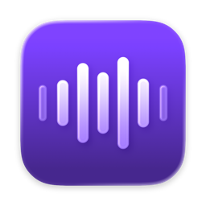

# Vaux

**Talk to your Mac. Not the meeting.**

If you dictate instead of typing, a call shouldn't take that away. But it does.
Start to speak a prompt to your agent, or a quick note, and the meeting hears
it. So you stop and find what to mute, pause what you were listening to, and
hope the call doesn't bleed into your mic. By then the thought is gone.

Vaux solos your voice to your dictation app, the way you'd solo one track on a
mixer, and the rest of the Mac makes room: your calls mute, your media pauses,
and if you like, your speakers come down. When you stop, it all goes back.
Dictation works on a call the way it does anywhere else.

Around that, Vaux manages your mic: one key mutes it everywhere, your mics
switch in the order you rank them, and each comes back at the volume you set.

It never touches your audio stream. There are no virtual or aggregate devices,
no HAL plugins, and no capture — only Core Audio property changes. That means no
Bluetooth quality drop, no added latency, and no microphone permission.

## Install

```sh
brew install --cask imathis/tap/vaux
```

Or download the zip from the latest
[release](https://github.com/imathis/vaux/releases/latest), unzip it, and move
Vaux to Applications. Requires macOS 26 or later.

Vaux lives in the menu bar. To update: `brew upgrade --cask vaux`.

## Features

### Solo mode

Solo is for dictating while you're on a call, on the same mic: your dictation
app hears you, and nothing else does.

Works with **Zoom**, **Google Meet** (in any browser), **FaceTime**, **Slack**
and **Discord**. Solo mode:

- Mutes you in every call you're in by pressing the call's own mute button, so
  everyone sees you as muted and nobody hears you dictate.
- Warns you if another app on the mic can still hear you: the menu bar icon
  turns orange and the menu names the app.
- Keeps your mic live for everything else, unmuting it if Vaux had it muted.
- Pauses music or video that's playing, and plays it again when solo ends.
  (macOS Dictation does this itself, so Vaux leaves media alone when the 🎤
  key starts solo.)
- Optionally lowers your speakers while it's on, so less of the call bleeds into
  the mic.
- Puts everything back when it ends: it unmutes only the apps it muted and
  leaves your speakers alone if you changed the volume yourself.

Start solo from the menu, a shortcut, or automatically while your dictation app
is listening. Or share a key with dictation, so one press starts both: the 🎤
Dictation key (the default, which starts macOS Dictation) or a tap of a
right-side modifier on its own (e.g. Right ⌥, for apps like FluidVoice). When
the shared key starts solo, Escape, which ends dictation, ends solo too.

#### How it works, and what that means

macOS can't mute your mic for one app but not another without a virtual audio
device, which costs quality and adds latency. So solo works the other way
around: it mutes you inside the call app, through Accessibility. Each app's
mute control is different, so apps are supported one by one. Microsoft Teams
and Webex aren't yet; if one is using the mic, solo warns you.

Google Meet works in browsers built on Chromium (Chrome, Arc, Edge, Brave,
Helium and most others) or WebKit (Safari), but not Firefox yet. The call has
to be the visible tab in its window, since browsers only expose that one.

### Mute

- One click or one shortcut mutes the current input. Unmuting restores a set
  volume, per input if you like.
- Devices without a hardware mute are muted by setting their volume to zero.
- Vaux follows the system default input live, and keeps it muted if you switch
  inputs while muted.
- The menu bar icon always shows the real state, even when mute is changed in
  System Settings or another app.

### Preferred inputs

- Turn on auto switch and rank your mics in Settings. Vaux switches to the
  highest-ranked one that's connected as devices come and go.
- The menu lists every input, marks the preferred one, and has an input volume
  slider and an auto switch toggle.

## Permissions

- **Mute and inputs:** none. Changing Core Audio properties doesn't trigger
  the microphone permission prompt.
- **Solo mode:** Accessibility, to press mute in your call apps, and to notice
  the key you share with dictation. Vaux reacts only to that key and Escape,
  and ignores every other key. While a Chromium browser is using the mic, Vaux
  turns on its full accessibility support (as a screen reader does) so Meet's
  mute button can be pressed, and turns it off again after.
- **Call and dictation detection:** none. Vaux reads which apps are using the
  mic from Core Audio's process list, without opening the mic itself.

## Usage

- The menu bar icon shows the state: voice bars when live, flat dots when
  muted, and three bars between two dots in solo (orange if something couldn't
  be muted or can still hear you).
- **Click** the icon to open the menu. **Shift-, Option- or Control-click** it
  to toggle mute.
- **Settings:** solo mode, mute, preferred inputs, and launch at login.

## Build and run

Requires macOS 26+, Xcode 26+ and
[XcodeGen](https://github.com/yonaskolb/XcodeGen) (`brew install xcodegen`).

The Xcode project is generated from [`project.yml`](project.yml) and isn't
checked in. Generate it first:

```sh
make open      # generate the project and open it in Xcode, then ⌘R
make run       # build and launch from the command line
```

On first build, Xcode resolves the one dependency,
[KeyboardShortcuts](https://github.com/sindresorhus/KeyboardShortcuts), via SPM.

To sign with your own team, set `DEVELOPMENT_TEAM` in `project.yml` and `TEAM`
in the `Makefile`. A free personal team is enough for local use.

If `xcode-select` points at the Command Line Tools, select Xcode first, or
prefix the command:
`DEVELOPER_DIR=/Applications/Xcode.app/Contents/Developer make run`.

### Releases

```sh
make install    # Release build signed with Developer ID, into /Applications
make notarize   # notarize and staple it, zipped in dist/ with its SHA-256
make publish    # tag, GitHub release with the zip, and update the Homebrew cask
```

`RELEASE` in the `Makefile` names the release (tag, zip, cask); the app's own
version is `MARKETING_VERSION` in `project.yml`. Notarizing needs the developer
account's `notarytool` login stored in the Keychain, `notarytool-profile` by
default (`NOTARY_PROFILE`).

### App Store builds

The App Sandbox entitlements are in `Sources/Vaux.entitlements` and are off by
default; see the comment in `project.yml`. Mute and inputs work sandboxed.
Pausing media uses a private framework, which the App Store doesn't allow, so
an App Store build would have to leave it out. Solo mode hasn't been tested
sandboxed yet.

## Layout

```
project.yml                  # XcodeGen spec: deployment target, signing, SPM
Makefile                     # gen / open / build / run / clean
Sources/
  main.swift                 # entry point
  AppDelegate.swift          # status item, clicks, Settings window
  StatusIcon.swift           # menu bar glyph: live, muted, solo
  StatusIconAnimator.swift   # springs the glyph between states
  MenuPanelController.swift  # the custom glass menu panel
  MenuContentView.swift      # menu: volume, inputs, mute, solo, settings
  SettingsView.swift         # Settings
  AppState.swift             # mute intent, device tracking, solo mode
  AudioController.swift      # Core Audio HAL: devices, mute, volume, processes
  CallMuter.swift            # presses call apps' mute via Accessibility
  CaptureWatcher.swift       # which apps are using the mic
  MediaPauser.swift          # pauses playing media during solo
  SoloKeyMonitor.swift       # solo key shared with dictation, and Escape
  SoloShortcutRecorder.swift # solo shortcut field (combos and modifier taps)
  InputVolumeView.swift      # volume slider
  InputPriorityModel.swift   # preferred-input list (Settings)
  PreferredInput.swift       # preferred-input order storage
  LaunchAtLogin.swift        # SMAppService wrapper
  Shortcuts.swift            # KeyboardShortcuts names
  AppStorageKey.swift        # shared settings keys
  Info.plist                 # LSUIElement: menu bar only, no Dock icon
  Vaux.entitlements          # App Sandbox (off by default)
  Vaux.icon                  # app icon (Icon Composer)
IconSource/                  # app icon layer art
docs/                        # README images
```

## Non-goals

No virtual audio devices or HAL plugins, no audio capture or level meters, no
push-to-talk, no HUD, no analytics, no networking, no auto-update.
